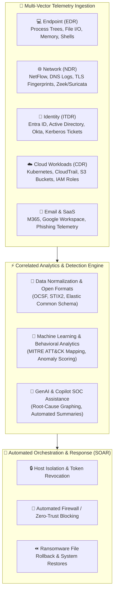

# 🛡️ Awesome Extended Detection & Response (XDR) 🎯

> **A comprehensive, SEO-optimized, curated guide to the top Extended Detection and Response (XDR), Endpoint Detection & Response (EDR), Security Information and Event Management (SIEM), and Security Orchestration (SOAR) platforms — featuring enterprise SaaS solutions and self-hosted open-source security frameworks.** 🔍⚡

🌟 **Star this repository to keep track of new XDR tools, telemetry engines, and threat detection intelligence!** 🌟

---

## 📑 Table of Contents

- [🌐 Sector Overview & Market Dynamics](#-sector-overview--market-dynamics)
- [🏢 SaaS & Hosted Commercial Platforms](#-saas--hosted-commercial-platforms)
  - [📊 SaaS Platforms Comparison Matrix](#-saas-platforms-comparison-matrix)
  - [🔍 Detailed SaaS Platform Breakdown](#-detailed-saas-platform-breakdown)
- [🔓 Open-Source Software & Telemetry Tools](#-open-source-software--telemetry-tools)
  - [⭐ Open-Source Repositories Ranked by Stars](#-open-source-repositories-ranked-by-stars)
  - [🛠️ Detailed Open-Source Project Breakdown](#-detailed-open-source-project-breakdown)
- [⚖️ Feature Comparison at a Glance](#-feature-comparison-at-a-glance)
- [🚀 Key XDR Architecture & Telemetry Pillars](#-key-xdr-architecture--telemetry-pillars)
- [📈 Star History](#-star-history)
- [💖 Support](#-support)
- [🤝 Contributing](#-contributing)
- [📄 License](#-license)

---

## 🌐 Sector Overview & Market Dynamics

The global **Extended Detection and Response (XDR)** market is estimated at **$3.2B to $4.1B in 2024–2026** and is projected to expand to over **$12.5B–$15.2B by 2030–2032** at an impressive compound annual growth rate (**CAGR of 22%–27%**), propelled by rapid multi-cloud adoption, identity-based credential attacks, remote workforce dispersion, and the operational fatigue of managing disconnected security point products.

The sector demonstrates a **moderately fragmented yet rapidly consolidating ecosystem**: mega-cap cybersecurity incumbents (Microsoft, Cisco, Palo Alto Networks, CrowdStrike) are aggressively bundling endpoint (EDR), network (NDR), identity (ITDR), and cloud detection (CDR) into unified "native XDR" suites, while agile "open XDR" vendors and modular open-source architectures thrive by ingesting heterogeneous telemetry without vendor lock-in.

---

## 🏢 SaaS & Hosted Commercial Platforms

Enterprise-grade, cloud-hosted Extended Detection and Response and Next-Gen SecOps platforms sorted descending by company scale (valuation / market capitalization / revenue).

### 📊 SaaS Platforms Comparison Matrix

| 🏢 Product / Vendor | 💰 Company Scale (Valuation / Mkt Cap) | 🏷️ Specific Starting Pricing Tier | 🎁 Specific Free Tier / Free Trial Limits | 🚀 Best For |
| :--- | :--- | :--- | :--- | :--- |
| **[Microsoft Defender XDR](https://www.microsoft.com/en-us/security/business/siem-and-xdr/microsoft-defender-xdr)** | **~$3.1 Trillion** (Market Cap) | **$3.00 / user / month** (Defender for Business) or **$5.20 / endpoint / month** (Defender for Endpoint P1) | **30-day free trial** (up to 25 user licenses with automated investigation and remediation) | Microsoft 365 & Azure-centric enterprises needing native cross-surface defense |
| **[Cisco XDR](https://www.cisco.com/site/us/en/products/security/xdr/index.html)** | **~$240 Billion** (Market Cap) | **$71.50 / endpoint / year** (~$5.95/endpoint/month via Cisco Commerce / AWS Marketplace) | **30-day interactive guided trial** with simulated telemetry feeds & automated response workflows | Cisco-centric network environments requiring deep NetFlow, firewall, and multi-cloud correlation |
| **[Palo Alto Cortex XDR](https://www.paloaltonetworks.com/cortex/cortex-xdr)** | **~$115 Billion** (Market Cap) | **$44.00 / endpoint / year** (Cortex XDR Prevent base tier, 100-endpoint annual bundle at ~$4,400/yr) | **30-day guided enterprise POC / trial** (up to 50 agent deployments with behavioral analytics & AIDR) | Enterprises seeking agentic AI triage, AI Detection & Response (AIDR), and runtime endpoint protection |
| **[CrowdStrike Falcon Insight XDR](https://www.crowdstrike.com/products/endpoint-security/falcon-insight-edr/)** | **~$85 Billion** (Market Cap) | **$59.99 / device / year** ($4.99/device/month billed annually for Falcon Pro tier) | **15-day free trial** (Falcon Pro/Insight up to 100 endpoints) + **10 GB/day permanently free** 3rd-party data ingest | Adversary-focused AI-native security, Charlotte AI automated investigation, and RTR containment |
| **[Elastic Security](https://www.elastic.co/security)** | **~$10 Billion** (Market Cap) | **$95.00 / month** (Elastic Cloud Standard cluster) or **$109.00 / month** (Elastic Cloud Security tier) | **14-day fully-featured Elastic Cloud free trial** with pre-built detection rules, Elastic Defend, and AI Assistant | Teams seeking unified XDR, SIEM, and SOAR with transparent open detection rules and zero per-agent license costs |
| **[Trend Micro Vision One](https://www.trendmicro.com/en_us/business/products/detection-response.html)** | **~$7.5 Billion** (Market Cap / TYO: 4704) | **$36.00 / credit / year** (~$1,800/yr base package for 50 endpoints via AWS Marketplace) | **30-day free trial** with 500 endpoint credits, sandbox analysis, and complete MITRE ATT&CK correlation matrix | Organizations demanding cross-layered native sensors (EDR, NDR, email, identity) and AI-driven SOC automation |
| **[SentinelOne Singularity XDR](https://www.sentinelone.com/platform/)** | **~$7.0 Billion** (Market Cap) | **$45.00 / endpoint / year** ($3.75/endpoint/month billed annually for Singularity Core tier) | **30-day free trial** (Singularity Platform access with Purple AI autonomous threat hunting for up to 50 endpoints) | Autonomous endpoint rollback, 1-click threat remediation, and cross-surface telemetry normalization |
| **[Sophos XDR](https://www.sophos.com/en-us/products/extended-detection-response)** | **~$3.9 Billion** (Acquired Valuation / ~$1.2B Rev) | **$45.00 / user / year** (Sophos Intercept X Advanced with XDR starting license) | **30-day free trial** with unlimited endpoint installations and 30 days of Sophos Data Lake retention | Existing Sophos firewall and endpoint customers looking for natural language investigations via Sophos AI |
| **[Trellix XDR](https://www.trellix.com/platform/xdr/)** | **~$2.5 Billion** (Enterprise Valuation / ~$1.8B Rev) | **$42.00 / endpoint / year** (Trellix Endpoint Protection & XDR foundation tier via AWS Marketplace) | **30-day guided virtual evaluation / POC** via Trellix XDR cloud console | Heterogeneous enterprise security stacks requiring open integration with 1,000+ third-party data feeds |
| **[Cynet 360 AutoXDR](https://www.cynet.com/)** | **~$300 Million** (Series C Valuation / $68M+ Raised) | **$35.00 / endpoint / year** (Cynet 360 All-in-One tier including 24/7 CyOps MDR) | **14-day free trial** for up to 25 endpoints with automated incident remediation and MDR escalation | Lean SecOps teams needing consolidated XDR, EDR, NDR, CSPM, and 24/7 managed detection & response included |

---

### 🔍 Detailed SaaS Platform Breakdown

#### 🛡️ Microsoft Defender XDR
- **Vendor:** Microsoft Corporation (Valuation: ~$3.1T)
- **Deployment:** Cloud-native SaaS
- **Core Architecture:** Coordinates natively across Defender for Endpoint, Office 365, Identity, Cloud Apps, Vulnerability Management, and Threat Intelligence. Related alerts are automatically grouped into a single unified incident, and automatic threat response shares detections cross-domain (e.g., auto-isolating an endpoint when a malicious payload is detected in an incoming phishing email). Deep two-way integration with Microsoft Sentinel for cloud SIEM and Security Exposure Management.
- **Pricing:** Starts at **$3.00/user/month** (Defender for Business) or **$5.20/endpoint/month** (Defender for Endpoint P1); bundled within Microsoft 365 E5 ($57/user/month).
- **Free Evaluation:** **30-day free trial** supporting up to 25 user licenses with complete automated investigation and response (AIR) capabilities.

#### 🌐 Cisco XDR
- **Vendor:** Cisco Systems, Inc. (Market Cap: ~$240B)
- **Deployment:** Multi-tenant Cloud SaaS
- **Core Architecture:** Ingests rich network telemetry from on-premises environments (NetFlow, SPAN, Cisco Secure Firewall logs) and public clouds (AWS, GCP, Azure) via native API connectors. Asset Insights unifies device and user inventory for incident context. Cisco XDR Automation provides no-to-low code workflows with an intuitive drag-and-drop designer triggered by security incidents, schedules, or inbound webhooks.
- **Pricing:** Base tier begins at **$71.50/endpoint/year** (~$5.95/endpoint/month) via Cisco Commerce and AWS Marketplace.
- **Free Evaluation:** **30-day interactive guided trial** pre-populated with realistic adversary attack scenarios and incident workflows.

#### ⚡ Palo Alto Cortex XDR
- **Vendor:** Palo Alto Networks, Inc. (Market Cap: ~$115B)
- **Deployment:** Cloud SaaS
- **Core Architecture:** Cortex XDR introduced advanced app control with binary inventory and execution guardrails, plus Runtime Protection and AI Detection & Response (AIDR) for monitoring AI agent activity across desktop and coding environments. A targeted sensor deployment model allows running Cortex modules alongside existing third-party EDRs. Includes a specialized fleet of AI agents for triage, enrichment, and containment with human-in-the-loop verification.
- **Pricing:** Starts at **$44.00/endpoint/year** for Cortex XDR Prevent (minimum 100-endpoint tier at ~$4,400/year).
- **Free Evaluation:** **30-day guided enterprise POC** supporting up to 50 agent deployments with behavioral analytics and automated playbooks.

#### 🦅 CrowdStrike Falcon Insight XDR
- **Vendor:** CrowdStrike Holdings, Inc. (Market Cap: ~$85B)
- **Deployment:** 100% Cloud-Native SaaS
- **Core Architecture:** Unifies EDR with identity, cloud, and mobile signals into a single unified console powered by the lightweight Falcon Agent. Key capabilities include Charlotte AI for conversational investigation leads, Falcon Fusion native SOAR for automated response, and Real Time Response (RTR) for direct remote system access and live forensics.
- **Pricing:** Starts at **$59.99/device/year** ($4.99/device/month billed annually) for Falcon Pro; Falcon Insight XDR begins at ~$99.99/endpoint/year.
- **Free Evaluation:** **15-day free trial** (Falcon Pro/Insight up to 100 endpoints) plus **10 GB/day permanently free** third-party data ingest.

#### 🔎 Elastic Security
- **Vendor:** Elastic N.V. (Market Cap: ~$10B)
- **Deployment:** Elastic Cloud SaaS / Self-Managed Hybrid
- **Core Architecture:** Native endpoint protection (Elastic Defend) with kernel-level sensors for Windows, Linux, macOS, and Kubernetes. Integrates XDR, SIEM, and SOAR natively into Elasticsearch without per-endpoint license penalties. Agentic AI assistants perform automated alert triage, context enrichment, case creation, and containment response. Detection logic is publicly maintained via open-source detection rules.
- **Pricing:** Cloud Standard starts at **$95.00/month**; Security tier starts at **$109.00/month** (resource-based cluster pricing, unlimited endpoints).
- **Free Evaluation:** **14-day fully-featured Elastic Cloud free trial** with pre-configured detection rules, SIEM dashboards, and Defend agents.

#### 👁️ Trend Micro Vision One
- **Vendor:** Trend Micro Inc. (Market Cap: ~$7.5B / TYO: 4704)
- **Deployment:** Cloud SaaS
- **Core Architecture:** Combines native sensors across endpoint (EDR), identity (ITDR), network (NDR), and email (EmDR). Trend Companion AI assists SecOps analysts with proactive triage and investigation automation. Achieved 100% analysis coverage in MITRE ATT&CK Enterprise Evaluations with end-to-end attack chain reconstruction.
- **Pricing:** Consumption-based credit system starting at **$36.00/credit/year** (entry package at ~$1,800/year for 50 endpoints).
- **Free Evaluation:** **30-day free trial** with 500 endpoint credits, sandbox detonation, and native attack-path visualizations.

#### 🟣 SentinelOne Singularity XDR
- **Vendor:** SentinelOne, Inc. (Market Cap: ~$7.0B)
- **Deployment:** Cloud-native SaaS
- **Core Architecture:** Ingests and normalizes telemetry across endpoint, identity, cloud, AI systems, and third-party tools into a single correlated Singularity Data Lake. Purple AI surfaces natural-language actionable insights, while automated Storyline tracking allows 1-click remediation and system rollback to a pre-infection state.
- **Pricing:** Singularity Core starts at **$45.00/endpoint/year** ($3.75/endpoint/month); Singularity Control/Complete starts at ~$69–$159/endpoint/year.
- **Free Evaluation:** **30-day free trial** of Singularity Platform with Purple AI and full attack story reconstruction for up to 50 endpoints.

#### 🔷 Sophos XDR
- **Vendor:** Sophos Group / Thoma Bravo (Valuation: ~$3.9B)
- **Deployment:** Cloud SaaS
- **Core Architecture:** Extends Intercept X EDR with third-party network, firewall, and cloud integrations feeding into the Sophos Data Lake. Threat Graph visually diagrams attack root cause, lateral movement, and affected processes. Live Discover facilitates SQL-based queries across endpoints, while Sophos AI Assistant interprets telemetry in plain conversational English.
- **Pricing:** Starts at **$45.00/user/year** for Sophos Intercept X Advanced with XDR.
- **Free Evaluation:** **30-day free trial** with unlimited endpoint installations and 30-day retention in the Sophos Data Lake.

#### ⚔️ Trellix XDR
- **Vendor:** Trellix / STG (Enterprise Valuation: ~$2.5B)
- **Deployment:** Cloud SaaS & Hybrid
- **Core Architecture:** Formed through the merger of McAfee Enterprise and FireEye. Ingests data from Trellix native security controls and 1,000+ third-party security products into an open data lake. Features multi-vector threat correlation powered by the Trellix Advanced Research Center (ARC) and automated response playbooks.
- **Pricing:** Starts at **$42.00/endpoint/year** for Trellix Endpoint Protection & XDR foundation tier.
- **Free Evaluation:** **30-day guided virtual evaluation / POC** via the Trellix XDR cloud management console.

#### 🎯 Cynet 360 AutoXDR
- **Vendor:** Cynet Security (Valuation: ~$300M)
- **Deployment:** Cloud SaaS
- **Core Architecture:** Consolidated SecOps platform natively combining NGAV, EPP, EDR (Windows, macOS, Linux), NDR, and SIEM-like log management in a single interface. Extends across cloud infrastructure via SSPM, CSPM, and Cloud Detection & Response. Uniquely includes 24/7 CyOps Managed Detection & Response (MDR) monitoring with every license.
- **Pricing:** Starts at **$35.00/endpoint/year** for Cynet 360 All-in-One tier (inclusive of 24/7 MDR services).
- **Free Evaluation:** **14-day free trial** for up to 25 endpoints with automated remediation playbooks and live MDR support.

---

## 🔓 Open-Source Software & Telemetry Tools

Self-hosted, community-driven XDR, EDR, SIEM, SOAR, and telemetry platforms. Ranked descending by GitHub stargazer count.

### ⭐ Open-Source Repositories Ranked by Stars

| 🛠️ Project Name | 🌟 GitHub Stars Badge (Links to Stargazers) | 💻 Primary Stack / Architecture | 📜 License | 🎯 Security Focus Area |
| :--- | :--- | :--- | :--- | :--- |
| **[osquery](https://github.com/osquery/osquery)** |  | C++, SQLite, CMake | Apache-2.0 | Endpoint Telemetry & SQL Analytics |
| **[Wazuh](https://github.com/wazuh/wazuh)** |  | C, C++, OpenSearch, Python | GPL-2.0 | Unified XDR & SIEM Platform |
| **[OpenCTI](https://github.com/OpenCTI-Platform/opencti)** |  | TypeScript, GraphQL, Python | Apache-2.0 | Cyber Threat Intelligence (CTI) |
| **[Falco](https://github.com/falcosecurity/falco)** |  | C++, eBPF, Lua | Apache-2.0 | Cloud-Native Runtime XDR & K8s Security |
| **[Zeek](https://github.com/zeek/zeek)** |  | C++, Zeek Script | BSD-3-Clause | Network Traffic Analysis & NDR Telemetry |
| **[Suricata](https://github.com/OISF/suricata)** |  | C, Rust | GPL-2.0 | Network IDS / IPS & Threat Detection |
| **[OSSEC](https://github.com/ossec/ossec-hids)** |  | C, Make | GPL-2.0 | Host Intrusion Detection (HIDS) |
| **[Security Onion](https://github.com/Security-Onion-Solutions/securityonion)** |  | Linux, SaltStack, Elastic/Suricata | AGPL-3.0 | Threat Hunting & Enterprise SOC Platform |
| **[Velociraptor](https://github.com/Velocidex/velociraptor)** |  | Go, VQL (Velociraptor Query Lang) | AGPL-3.0 | Endpoint Visibility & Digital Forensics (DFIR) |
| **[Shuffle SOAR](https://github.com/Shuffle/Shuffle)** |  | Python, Go, Docker | AGPL-3.0 | Security Orchestration & Auto-Response (SOAR) |
| **[Matano](https://github.com/matanolabs/matano)** |  | Rust, AWS Lambda, Apache Iceberg | Apache-2.0 | Serverless Cloud SIEM & Data Lake |
| **[Apache Metron](https://github.com/apache/metron)** |  | Java, Apache Storm, Hadoop | Apache-2.0 | Big Data Cybersecurity Analytics |
| **[UTMStack](https://github.com/utmstack/UTMStack)** |  | Python, Go, Docker, Angular | GPL-3.0 | Unified SIEM, XDR & Compliance Engine |

---

### 🛠️ Detailed Open-Source Project Breakdown

#### 💻 [osquery](https://github.com/osquery/osquery)
- **Repository:** `osquery/osquery` | **License:** Apache-2.0  
- **Description:** Exposes an entire operating system as a high-performance relational database. Security analysts can write SQL queries to inspect running processes, open network sockets, loaded kernel modules, browser extensions, and hardware devices. Widely adopted as the primary endpoint instrumentation layer inside modern commercial and open-source XDR agents.  
- **Best For:** Security engineers and DFIR teams seeking granular, cross-platform host visibility using standard SQL.

#### 🛡️ [Wazuh](https://github.com/wazuh/wazuh)
- **Repository:** `wazuh/wazuh` | **License:** GPL-2.0  
- **Description:** The industry standard for open-source XDR and SIEM. Integrates a lightweight multi-platform agent with an OpenSearch-backed indexer and centralized dashboard. Out of the box, it delivers File Integrity Monitoring (FIM) with who-data attribution, automated CVE vulnerability scanning, CIS security benchmark audits, and 3,000+ MITRE ATT&CK rules. Active response triggers automated endpoint isolation, firewall blocklists, or service suspension.  
- **Best For:** Organizations seeking a complete, self-hosted, enterprise-ready XDR/SIEM platform with zero per-agent license costs.

#### 🧠 [OpenCTI](https://github.com/OpenCTI-Platform/opencti)
- **Repository:** `OpenCTI-Platform/opencti` | **License:** Apache-2.0  
- **Description:** An open-source Cyber Threat Intelligence (CTI) management platform designed to structure, enrich, and visualize adversary tactics, techniques, and procedures (TTPs). Connects directly into XDR and SIEM pipelines via STIX2 standards to provide real-time indicator correlation, IOC scoring, and threat actor tracking.  
- **Best For:** Threat intelligence analysts and SOC teams needing structured threat intelligence to feed XDR detection rules.

#### ☁️ [Falco](https://github.com/falcosecurity/falco)
- **Repository:** `falcosecurity/falco` | **License:** Apache-2.0  
- **Description:** Originally created by Sysdig and graduated under the CNCF, Falco provides real-time threat detection across Kubernetes clusters, containers, and Linux hosts using eBPF probes. Captures kernel syscalls and alerts on unauthorized container escapes, unexpected outbound shell connections, privilege escalations, and sensitive file modifications.  
- **Best For:** DevOps and SecOps teams requiring cloud-native runtime security and containerized workload XDR.

#### 🌐 [Zeek](https://github.com/zeek/zeek)
- **Repository:** `zeek/zeek` | **License:** BSD-3-Clause  
- **Description:** A powerful network analysis and security monitoring framework fundamentally different from standard signature-based IDS. Zeek inspects raw network traffic, interprets dozens of application-layer protocols (DNS, HTTP, TLS, SSH, Kerberos), and generates structured, transaction-level audit logs ideal for hunting lateral movement and command-and-control (C2) beacons.  
- **Best For:** Network detection and response (NDR) telemetry collection and deep protocol behavioral analysis.

#### 🚨 [Suricata](https://github.com/OISF/suricata)
- **Repository:** `OISF/suricata` | **License:** GPL-2.0  
- **Description:** A multi-threaded, high-performance Network Threat Detection engine developed by OISF. Capable of real-time Intrusion Detection (IDS), inline Intrusion Prevention (IPS), and network security monitoring (NSM). Supports standard Emerging Threats rulesets, automated protocol parsing, and high-throughput multi-gigabit traffic inspection.  
- **Best For:** High-throughput network perimeter monitoring and signature-based exploit blocking.

#### 🔒 [OSSEC](https://github.com/ossec/ossec-hids)
- **Repository:** `ossec/ossec-hids` | **License:** GPL-2.0  
- **Description:** A mature, time-tested host-based intrusion detection system (HIDS). Performs centralized log analysis, file integrity verification, Windows registry monitoring, rootkit identification, and immediate active response across legacy and modern servers.  
- **Best For:** Lightweight host intrusion detection on heterogeneous Linux and Unix server farms.

#### 🧅 [Security Onion](https://github.com/Security-Onion-Solutions/securityonion)
- **Repository:** `Security-Onion-Solutions/securityonion` | **License:** AGPL-3.0  
- **Description:** A turnkey Linux distribution and SOC ecosystem for threat hunting, network security monitoring, and log analysis. Packs together pre-configured integrations of osquery, Suricata, Zeek, Wazuh, CyberChef, and an intuitive Elastic/OpenSearch hunting dashboard with full packet capture (PCAP) playback.  
- **Best For:** Rapid deployment of an all-in-one SOC monitoring and threat-hunting appliance.

#### 🔎 [Velociraptor](https://github.com/Velocidex/velociraptor)
- **Repository:** `Velocidex/velociraptor` | **License:** AGPL-3.0  
- **Description:** An advanced digital forensics and incident response (DFIR) platform engineered by Rapid7. Utilizes the Velociraptor Query Language (VQL) to conduct surgical endpoint investigations, memory scraping, MFT artifact parsing, and live remediation across thousands of endpoints simultaneously in seconds.  
- **Best For:** Incident responders conducting live digital forensics, memory analysis, and enterprise-wide breach triage.

#### 🔀 [Shuffle SOAR](https://github.com/Shuffle/Shuffle)
- **Repository:** `Shuffle/Shuffle` | **License:** AGPL-3.0  
- **Description:** An open-source, OpenAPI-compliant Security Orchestration, Automation, and Response (SOAR) solution. Features an intuitive visual drag-and-drop workflow builder that connects EDRs, SIEMs, firewalls, and ticketing systems (TheHive, Jira) to automate alert triage, threat enrichment, and automated quarantine playbooks.  
- **Best For:** Security teams seeking automated cross-tool containment workflows without expensive commercial SOAR software.

#### 🧊 [Matano](https://github.com/matanolabs/matano)
- **Repository:** `matanolabs/matano` | **License:** Apache-2.0  
- **Description:** A serverless, cloud-native security data lake built in Rust for AWS. Ingests petabyte-scale security logs into Apache Iceberg tables in S3, enabling real-time detection-as-code written in Python. Queryable from Amazon Athena, Snowflake, or DuckDB with zero server management overhead.  
- **Best For:** Cloud-first teams wanting cost-efficient, open-table-format security analytics and detection-as-code.

#### ⚡ [Apache Metron](https://github.com/apache/metron)
- **Repository:** `apache/metron` | **License:** Apache-2.0  
- **Description:** An enterprise big-data cybersecurity platform integrating Apache Storm, Kafka, and Hadoop. Aggregates streaming logs and raw packet captures, applies machine learning models via Model-as-a-Service, and presents enriched alerts with contextual threat intelligence.  
- **Best For:** Large enterprises with existing Apache big-data clusters requiring high-scale stream processing.

#### 🧰 [UTMStack](https://github.com/utmstack/UTMStack)
- **Repository:** `utmstack/UTMStack` | **License:** GPL-3.0  
- **Description:** A unified open-source platform combining SIEM, XDR, and SOAR capabilities. Replaced legacy log shippers with a custom EventProcessor for horizontal scalability. Includes built-in compliance dashboards (HIPAA, PCI-DSS, GDPR), SOC-AI assistance, and visual workflow rules.  
- **Best For:** Small-to-medium enterprises wanting an integrated, turnkey open-source SIEM and XDR appliance.

---

## ⚖️ Feature Comparison at a Glance

| 🛡️ Platform / Tool | 📜 Type / License | 💻 Native EDR Agent | 🌐 Network Telemetry (NDR) | ☁️ Cloud & K8s Security | 🚀 Automated SOAR Playbooks | 💡 Ideal Deployment Scope |
| :--- | :--- | :---: | :---: | :---: | :---: | :--- |
| **Falcon Insight XDR** | Proprietary SaaS | ✅ | ⚠️ *(Via Integrations)* | ✅ | ✅ *(Falcon Fusion)* | Adversary-first enterprise SOCs |
| **Cortex XDR** | Proprietary SaaS | ✅ | ✅ | ✅ | ✅ *(XSOAR)* | AI agent & hybrid enterprise defense |
| **Singularity XDR** | Proprietary SaaS | ✅ | ⚠️ *(Via Integrations)* | ✅ | ✅ *(Storyline/Purple AI)* | Autonomous remediation & rollback |
| **Microsoft Defender XDR** | Proprietary SaaS | ✅ | ⚠️ *(Via Sentinel)* | ✅ | ✅ *(AIR Automations)* | Microsoft 365 & Azure environments |
| **Cisco XDR** | Proprietary SaaS | ⚠️ *(Via Secure Client)* | ✅ | ✅ | ✅ *(Cisco Automation)* | Cisco network-heavy infrastructures |
| **Trend Micro Vision One** | Proprietary SaaS | ✅ | ✅ | ✅ | ✅ *(Trend Companion)* | Broad native sensor correlation |
| **Elastic Security** | Proprietary SaaS / Free Tier | ✅ | ✅ *(Packetbeat)* | ✅ | ✅ *(Elastic Workflows)* | Open rule visibility & no per-agent fee |
| **Sophos XDR** | Proprietary SaaS | ✅ | ⚠️ *(Via Firewall)* | ⚠️ | ✅ *(Sophos AI)* | Mid-market Sophos ecosystems |
| **Trellix XDR** | Proprietary SaaS | ✅ | ✅ | ✅ | ✅ *(Trellix Playbooks)* | Heterogeneous multi-vendor environments |
| **Cynet 360 AutoXDR** | Proprietary SaaS | ✅ | ✅ | ✅ | ✅ *(Built-in SOAR + MDR)* | Lean teams wanting bundled 24/7 MDR |
| **Wazuh** | Open Source (GPL-2.0) | ✅ | ⚠️ *(Via Syslog/Suricata)* | ✅ | ✅ *(Active Response)* | Complete self-hosted open-source XDR |
| **osquery** | Open Source (Apache-2.0) | ✅ *(Telemetry)* | ⚠️ *(Socket Audit)* | ⚠️ | ❌ | Universal SQL-based host visibility |
| **Falco** | Open Source (Apache-2.0) | ❌ | ❌ | ✅ *(eBPF Kernel)* | ⚠️ *(Via Sidekick)* | Kubernetes runtime anomaly detection |
| **Security Onion** | Open Source (AGPL-3.0) | ✅ *(osquery/Wazuh)* | ✅ *(Zeek/Suricata)* | ⚠️ | ✅ | Turnkey SOC appliance & PCAP hunting |
| **Velociraptor** | Open Source (AGPL-3.0) | ✅ *(Forensic VQL)* | ❌ | ⚠️ | ✅ *(VQL Artifacts)* | Rapid digital forensics & triage |
| **Shuffle SOAR** | Open Source (AGPL-3.0) | ❌ | ❌ | ✅ | ✅ *(Full Visual SOAR)* | Cross-tool automated response workflows |
| **Matano** | Open Source (Apache-2.0) | ❌ | ⚠️ *(S3 Ingest)* | ✅ | ⚠️ *(Detection-as-Code)* | AWS serverless security data lake |

---

## 🚀 Key XDR Architecture & Telemetry Pillars

Modern Extended Detection and Response (XDR) platforms break down operational silos by unifying telemetry across five foundational security layers:

1. **💻 Endpoint Telemetry (EDR):** Inspects kernel events, process lineage, file modifications, memory injections, and PowerShell/Bash execution chains.
2. **🌐 Network Telemetry (NDR):** Analyzes unencrypted network metadata, beaconing patterns, domain generation algorithms (DGA), and DNS exfiltration paths.
3. **🔑 Identity Telemetry (ITDR):** Flags credential stuffing, anomalous lateral logins, Golden Ticket attacks, and impossible travel patterns.
4. **☁️ Cloud & Container Telemetry (CDR):** Ingests control-plane audit logs (AWS CloudTrail, GCP Audit Logs) and eBPF container syscalls (Falco).
5. **🚀 Automated Response (SOAR):** Executes instant isolation of compromised hosts, revokes Active Directory / OAuth session tokens, and blocks malicious IPs at the perimeter.

---

## 📈 Star History

---

## 💖 Support

Thank you so much for visiting and utilizing this guide! 🙏

If you found this curated Extended Detection & Response directory helpful to your team, research, or security operations:
- ⭐ **Star** this repository to help other cybersecurity professionals find it!
- 🍴 **Fork** it to build and customize your own internal SecOps checklists.
- 📢 **Share** it across your favorite security communities, LinkedIn, X/Twitter, or Reddit.

If you would like to support the ongoing maintenance and curation of open-source security intelligence:

Or visit the [GitHub Sponsors Dashboard](https://github.com/sponsors/ishandutta2007) directly. Thank you for your generosity and support! ☕✨

---

## 🤝 Contributing

Contributions, feature suggestions, and tool additions are warmly welcomed! 🌟

If you maintain or love an open-source or enterprise XDR platform that is actively maintained, please feel free to:
1. Fork this repository 🍴
2. Create your feature branch (`git checkout -b feature/add-new-xdr-platform`)
3. Commit your changes (`git commit -m 'feat: Add New-XDR-Platform'`)
4. Push to the branch (`git push origin feature/add-new-xdr-platform`)
5. Open a well-documented Pull Request 🚀

Please ensure all added open-source projects include their GitHub URL, active license, primary language stack, and a clear explanation of what makes them stand out.

---

## 📄 License

This compilation is distributed under the **Creative Commons Zero v1.0 Universal** ([CC0 1.0](https://creativecommons.org/publicdomain/zero/1.0/)) public domain dedication. Listed commercial platforms and open-source software tools are property of their respective owners and maintainers.

---

**⭐ Found this XDR directory helpful? Star this repository to support continuous updates! ⭐**

Made with ❤️ for the global Infosec, SecOps, and Threat Hunting communities.

